基于FPGA的多维交互
实时多音色合成电子乐器

摘要

本作品面向多维交互电子乐器演奏，以高云FPGA为实时音频计算核心，将八路光电选音、双轴摇杆、K230视觉手势与Android多指触屏接入统一硬件合成引擎。FPGA以HDL实现32份独立声部的相位、频率与包络状态，通过帧内时分流水线完成加法合成、ADSR、实时混音和数字效果运算，再经I²S连接PCM5102A输出声音。K230负责手势识别，手机承担演奏控制与配置，声音由实时演奏事件逐样本生成。

系统提供电钢琴、风琴、弦乐与Bass四种音色，支持连续弯音、起音力度、颤音、捏合音量和高度明亮度调节，FPGA内部实现合唱、延迟与混响。OLED提供波形、16带频谱、立体声李萨如图形、曲谱指引及声部状态，配合LED完成演奏反馈。手机扩展支持包络和效果组合设置、文本曲谱在线获取与缓存下发、键位映射及短时数字录音回传。

作品采用Tang Primer 20K开发板，配套E049硬件设计与App 0.16。主时钟设计值27 MHz，音频帧576周期，设计输出率46,875 Hz，32声部对应设计吞吐量1,500,000声部样本每秒。系统已形成实物样机、HDL与移动端源码、测试台和演示视频，体现了独立声部状态、多维表情和硬件可视化相结合的设计方法。

关键词：FPGA；实时合成；32声部；ADSR；多维交互；I²S

第一部分  作品概述

功能与特性

作品支持光电键与手机触屏两种选音方式，可进行单音、和弦保持和独立松键；摇杆弯音、起音力度以及视觉捏合、高度分别对应音高、强弱和明亮度。四种音色由同一硬件引擎实时合成，ADSR包络可配置，合唱、延迟和混响可独立组合。设备本地运行曲谱并给出演奏指引，手机提供曲谱下载、键位配置、显示切页、32声部测试和短录音WAV导出。

应用领域

作品适用于电子乐器交互体验、音乐与数字系统教学、实时合成算法实验和FPGA工程展示。光电选音降低接触式机械结构需求，摇杆与视觉手势为演奏增加表情维度，OLED将声音变化转化为可观察的图形。模块化输入、独立声部与手机配置也便于开展传感器映射、音色参数和复音调度的教学实验。

主要技术特点

音频路径采用HDL实现，32个声部分别维护相位、频率、力度和包络状态，共享运算单元在音频帧内完成流水调度。数学正弦表与加法运算产生四种音色；表达增益、颤音、数字效果和立体声输出与声部引擎衔接。交互侧采用光电采集、ADC和串口协议，控制侧由Android直连ESP；OLED与LED依据硬件状态生成反馈。

主要性能指标

项目 | 实现参数
复音结构 | 32份独立声部状态
音色及效果 | 4音色；合唱、延迟、混响
音频时钟设计 | 27 MHz；576周期/帧；46,875 Hz
音频接口 | 16位立体声I²S至PCM5102A
演奏与显示 | 8路光键；32位置映射；5页OLED
曲谱与录音 | 64事件；128块短PCM回传与WAV导出

主要创新点

（1）用独立声部状态结合共享流水线，在有限FPGA资源上组织32声部实时合成。

（2）将光电选音、摇杆和视觉手势映射为不同演奏参数，形成组合表情控制。

（3）把曲谱、键位映射、音频回传和硬件可视化接入同一引擎，增强演奏与教学的可观察性。

设计流程

从赛题功能分解出发，先建立光键、ADSR、混音与I²S发声链路，再扩展独立声部、四音色和多维表情；随后接入数字效果、OLED与曲谱，完成手机配置和录音回传。通过RTL、协议、设备回读、真实手机与DAC录音分层检查，最后完成样机集成和演示素材。

第二部分  系统组成及功能说明

整体介绍

系统分为演奏输入、FPGA音频、输出显示和手机扩展四层。光电模块给出选音与门控，摇杆经ADS1015提供连续控制量，K230输出手势参数，ESP接入手机指令。FPGA将输入统一为门控掩码、音色、音区、力度与表情参数，通过独立声部状态计算音频，再送往DAC，同时产生可视化与状态回传。

音频与辅助控制有明确分工：视觉识别和网络交互提供参数，声部合成、包络、混音、效果及音频时序由FPGA执行。曲谱以音符和时值事件驱动同一引擎，《欢乐颂》自动播放同样采用事件实时合成。

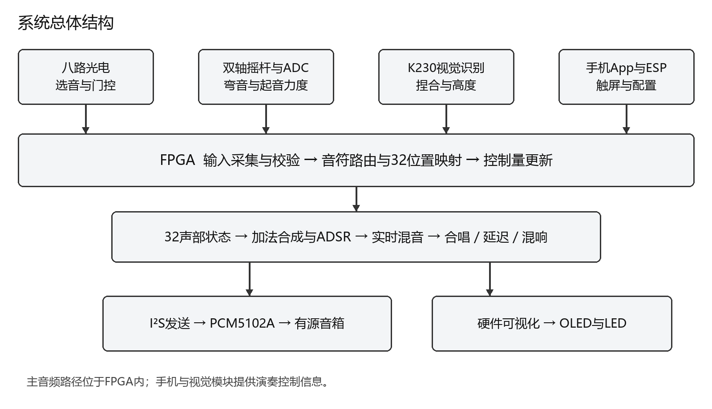

图1 系统总体结构与数据方向

硬件系统介绍

2.2.1 硬件整体介绍

主控采用Tang Primer 20K与Dock，搭载高云GW2A系列FPGA。八路光电模块布置于前侧演奏区；摇杆与OLED置于上面板；K230视觉模块通过支架固定，便于调整识别方向。主控和接口模块置于壳体内，PCM5102A连接外部有源音箱。

各模块围绕FPGA分配接口：独立I²C通路连接光电、ADC与OLED；串口分别连接K230与ESP；I²S连接DAC。控制和显示链路与逐样本音频调度分工运行，便于按模块检查和扩展。

模块 | 主要功能 | 接口
GW2A FPGA | 合成、控制、可视化 | HDL硬件逻辑
八路光电 | 选音与和弦门控 | I²C
摇杆与ADS1015 | 弯音、起音力度及按键 | ADC / I²C / GPIO
K230 | 手部关键点与表达参数 | UART 115200 8N1
ESP-01S | 热点与TCP交互 | UART / Wi-Fi
PCM5102A | 数字音频转模拟输出 | I²S
OLED与LED | 波形、状态与曲目反馈 | I²C / GPIO

2.2.2 机械设计介绍

样机采用面板与支撑件组合结构。前侧光电演奏区朝向使用者，右侧摇杆位于手部易触及位置，OLED与视觉模块放置在上部，保持操作和观察空间。内部支撑件固定主控板，模块连线在壳体内外分区布置，视觉模块与音箱通过连接线接入。

结构设计围绕演奏布局展开：光键负责离散触发，摇杆提供连续动作，摄像头覆盖手势区域，OLED面向演奏者。图示给出相对位置和功能分区，便于结合样机照片理解安装关系。

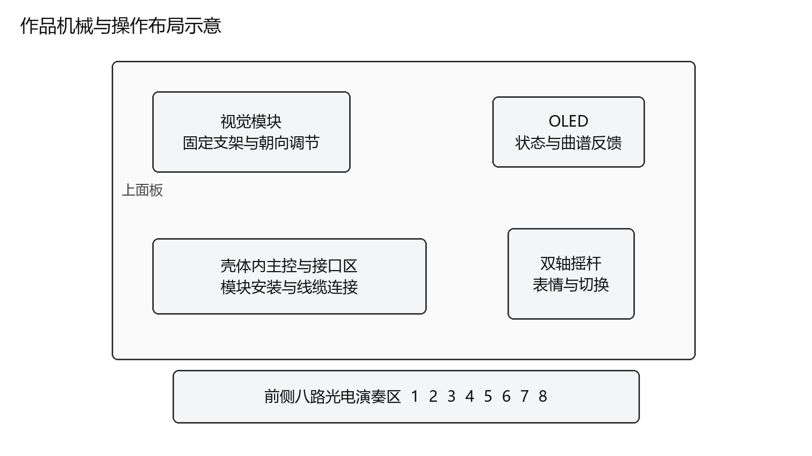

图2 操作面板与内部模块相对布局示意

2.2.3 电路各模块介绍

光电模块通过T9/P9连接FPGA，采集八路触发状态并形成音符门控；ADS1015通过T6/T7读取摇杆A0、A1，摇杆按键接T8。K230的UART1 TX引脚IO9接FPGA M14，按固定格式传送序号、有效标志、捏合、高度与置信度，FPGA接收和校验后更新表达量。

ESP发送方向接FPGA T12，接收方向接R11；手机通过ESP热点与FPGA交换触控和配置指令。OLED使用T11/P11。音频输出由P6、R8、P8分别提供DATA、BCK和LRCK，连接PCM5102A。模块共地，数字逻辑信号按工程约束采用对应电平域。

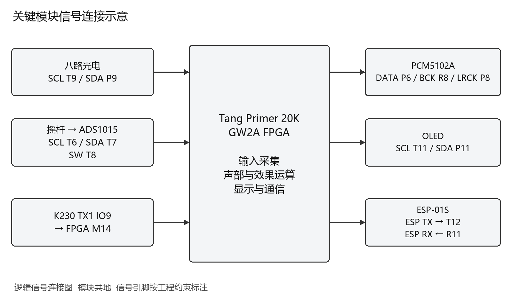

图3 关键输入输出与FPGA引脚对应关系

软件系统介绍

2.3.1 软件整体介绍

系统软件由HDL、K230视觉程序与Android伴侣组成。HDL承担输入协议、声部引擎、音频效果、曲谱、显示与回传；K230提取手部信息并编码发送；Android保留原版自绘演奏界面，通过Wi-Fi完成多指键盘、参数设置和文件交互。PC用于开发、编译、测试与资料整理。

手机“设置—直连扩展”提供颤音、ADSR、三效果组合、五页显示、32声部测试、文本曲谱、键位映射和录音入口。在线曲谱先通过互联网下载至手机缓存，再切换设备热点下发，设备回读确认后可本地播放。

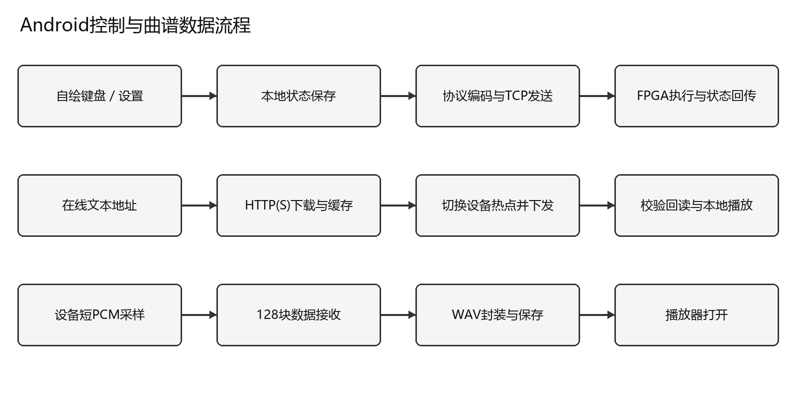

图4 App控制 曲谱下载与录音数据流程

2.3.2 软件各模块介绍

（1）输入管理与音符路由

光键与触屏输入统一为32位门控掩码gate_mask，结合当前音区和32位置映射表确定目标音符。连续控制量分别形成bend、velocity、brightness与expression。起音力度在新音触发时采样，持续弯音和捏合在演奏期间更新，释放门控则使对应声部进入释放阶段。

模块 | 关键输入 | 关键输出
输入与路由 | 光键、触屏、音区、映射 | gate_mask[31:0]
手势表达 | 有效标志、捏合、高度 | expression、brightness
synth32 | gate_mask、timbre、velocity、bend | sample、voice_count
fx_engine | 音频样本、效果位组合 | 左右声道样本
i2s_tx16 | 左右声道及音频节拍 | DATA、BCK、LRCK
曲谱与指引 | 音符事件、时值、映射 | 门控、目标键、BANK提示
App协议层 | 本地设置与触控事件 | 控制帧、状态解析、PCM/WAV

（2）32声部与音色计算

synth32为32个音符位置分别保存32位相位、频率控制量、包络状态、电平、计数与力度。相位更新遵循phase_next = phase + FCW；频率控制字FCW由目标频率f按32位相位尺度与采样率Fs换算。通过数学正弦表和加法分量运算形成电钢琴、风琴、弦乐与Bass。普通谐波分量属于音色构成，声部计数依据完整独立状态。

算术单元采用帧内时分复用，各声部状态相互独立。源码给出的32声部渲染预算为288个时钟，音频帧为576个时钟；该设计在同一帧内依次完成声部取数、更新、合成和累加，再进入表达与效果处理。

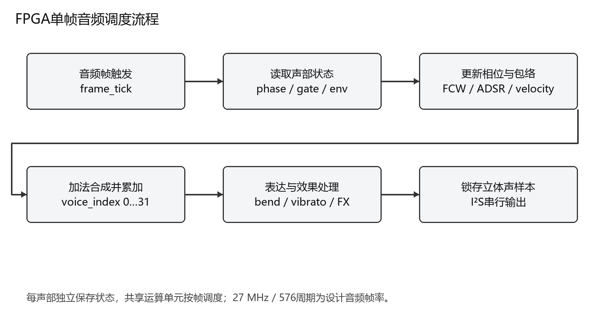

图5 32声部帧内调度与音频输出流程

（3）ADSR与表情控制

包络包括起音A、衰减D、保持S和释放R。A、D、R以0至15索引配置，S为0至255电平；参数作用于新触发声部。按键保持时维持包络，松开后仅释放对应声部。摇杆连续调节弯音，颤音深度控制周期性音高变化，捏合调节表达增益，高度改变明亮度。

（4）数字效果与显示

效果器通过三位组合分别控制合唱、延迟与混响；音频先完成多声部混音与增益处理，再进入效果运算。OLED波形来自实时音频，16带频谱采用硬件滤波器组，XY页使用左右声道坐标。曲谱页结合目标音、当前音区和映射表给出键位提示，系统页反馈声部数和模式。

（5）手机状态 曲谱与录音

ReferenceActivity连接自绘键盘和直连扩展，WifiSession管理TCP收发，协议类负责帧编码、范围校验和状态解析。效果组合保存在本地，并与主界面硬件延迟状态同步；联网时向设备发送配置。

曲谱下载模块完成HTTP(S)文本获取和缓存，FPGA接收最多64个音符时值事件并回读。键位配置按32位置写入及确认。录音模块采集约0.7秒的8位单声道数字PCM，分128块回传，由手机封装WAV并导出。

第三部分  完成情况及性能参数

整体介绍

作品已集成为桌面演奏样机。外观将光电演奏区、摇杆、OLED和视觉模块集中在同一操作结构上，外接DAC与音箱形成完整发声系统。以下实物照片展示面板、光电阵列及侧面安装关系。

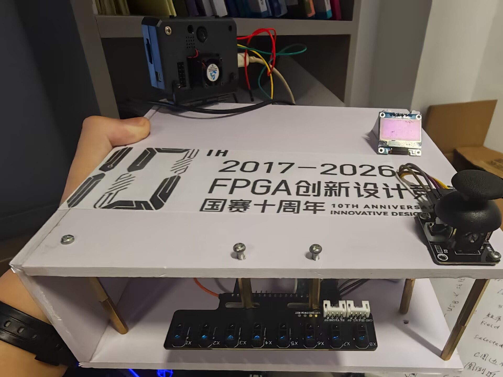

图6 作品整体面板与前侧光电演奏区实物

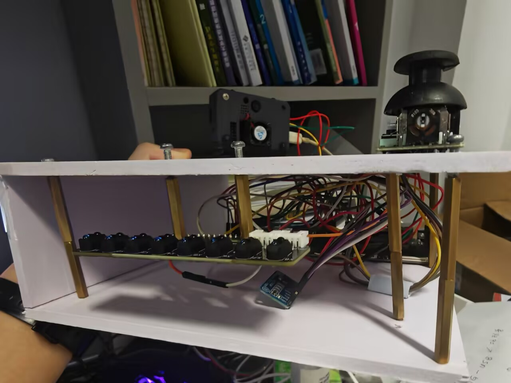

图7 支撑结构 光电阵列与内部模块布局实物

工程成果

3.2.1 机械成果

完成面板、内部支撑和模块固定；光电区朝向操作者，摇杆位于面板一侧，OLED和视觉模块在上部提供反馈。模块布局与输入功能相对应，便于在同一位置完成选音、连续控制和状态观察。

3.2.2 电路成果

完成FPGA、ADC、光电、视觉串口、热点通信、OLED与I²S DAC连接。图中为主控与线缆连接的实物局部，关键引脚对应关系见第二部分信号图。E049设计构建入口、约束与源文件随源码仓库提供。

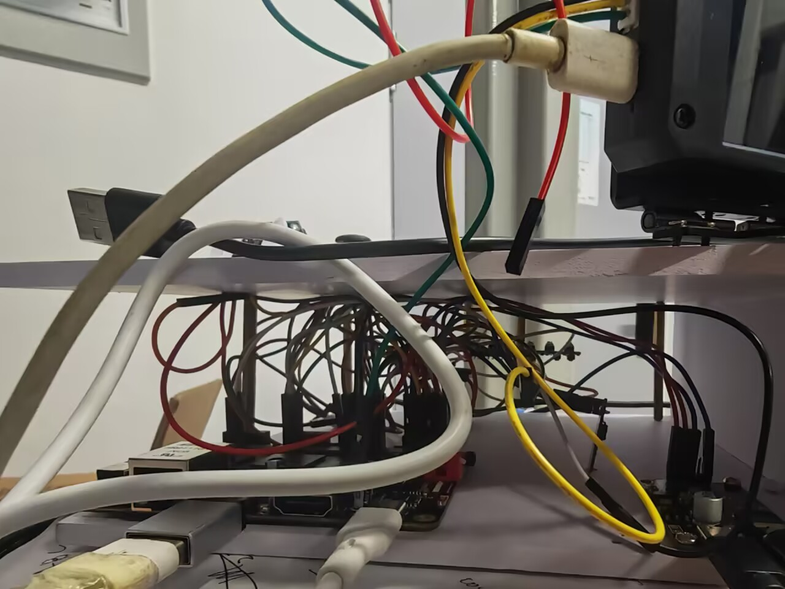

图8 主控板 DAC模块与内部连线实物

3.2.3 软件成果

完成原版自绘演奏界面与直连扩展设置。下图为原版APK运行界面的包络及效果设置页；同一扩展中可继续进行曲谱、映射和录音操作。

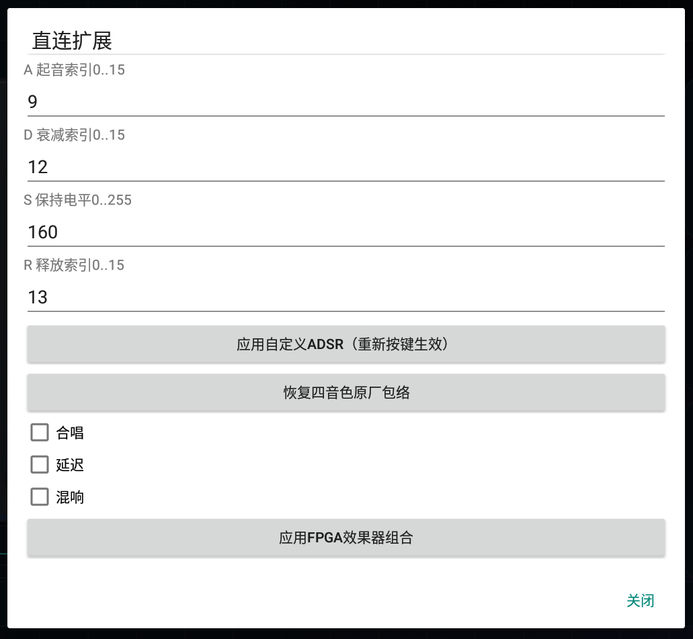

图9 App直连扩展 ADSR与效果设置界面

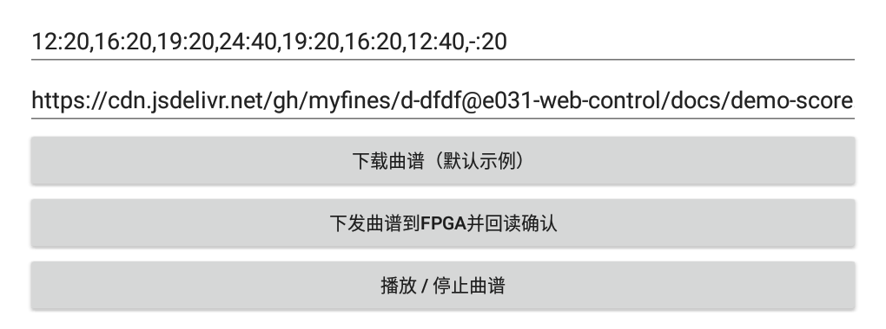

图10 App曲谱文本下载与下发界面局部

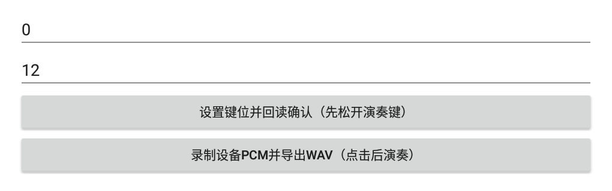

图11 App键位映射与PCM录音回传界面局部

特性成果

测试结合RTL、协议、设备回读、真实手机交互、DAC录音与演示素材。下表给出主要功能的实现与展示对应，设计值按其来源标注；已有测试数据用于说明具体配置下的行为。

赛题对应 | 本作品实现与成果
多维交互 | 光键选音与和弦，摇杆弯音与力度，捏合音量及高度明亮度
硬件实时合成 | HDL声部、ADSR、混音、效果与I²S输出，实时事件驱动
独立复音 | 四音保持与逐个释放；32份独立相位、频率和包络状态
规模与吞吐 | 32声部测试与分组分析；设计32×46,875＝150万声部样本/秒
音色与音效 | 4音色，显式颤音；合唱、延迟、混响独立组合
实时反馈 | 波形、16带频谱、XY、曲谱和系统页，LED分组指引
智能扩展 | 文本曲谱获取及缓存下发，32位置映射，短PCM回传与WAV导出

3.3.1 功能与回归检查

全系统回归记录包含50个RTL测试台、21项Python工具测试、32项K230单测和7组App测试。真实手机常规流程覆盖64项检查及多指、边界、连接恢复、曲谱下载缓存下发与WAV导出。App 0.16效果配置另完成本地状态保存与内外开关同步回归。

3.3.2 典型数据与演示

检查项目 | 记录结果 | 说明
四音逐个释放 | 15→7→3→1→0 | 真实手机事件到设备门控掩码
摇杆采集 | X 0～1646；Y 0～1647 | 442个采样快照
摇杆弯音 | 约233～294 Hz | 该次模拟音频录音分析
捏合幅度反馈 | 低/高捏合中位跨度1/14 | 相同条件回传PCM相对幅度
32声部分组 | 32→16→16 | 诊断模式与多频录音分析
录音回传 | 128块；WAV字节一致 | 设备接收与播放器检查

四音素材采用持续保持后逐个释放的动作；32声部模式通过独立状态和多频输出对应。捏合数据为同一手机持音条件下的回传PCM相对幅度，和模拟弯音录音共同说明不同输入链路能够改变实际声音参数。

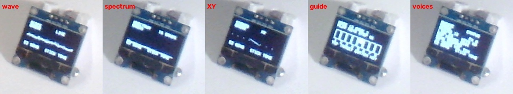

图12 OLED波形 频谱 XY 曲谱及声部页面实拍

演示视频以实物操作展示光键、和弦、摇杆、手势、四音色、颤音、OLED与32声部模式，并介绍手机扩展设置。源码按模块组织，报告图示、输入输出变量与RTL文件相对应。

第四部分  总结

可扩展之处

系统可沿现有模块边界扩展更多传感器映射、音色参数、曲目交互和教学模式。独立声部状态与统一控制量便于替换前端输入，效果器接口支持进一步组织声音处理；手机曲谱与键位配置可用于不同练习场景。可视化也可延伸至更大显示器，呈现声部包络、频带能量与演奏轨迹，使作品同时成为演奏工具与实时数字音频实验平台。

心得体会

本作品的开发围绕“动作如何成为声音”展开。设计中先将选音、起音力度、持续表情和参数配置区分，再把不同来源的数据统一为硬件控制量，避免传感器种类增加后使音频路径变得分散。这样，光键与手机可以共用声部引擎，手势和摇杆则在同一条音频链路中形成不同表达。

复音设计的关键是状态独立与帧内计算的配合。每个声部拥有自己的相位和包络，共享算术单元则按固定调度推进。理解这一点后，复音数、资源使用与采样帧之间可以建立明确关系，也能通过逐音释放和分组测试观察设计行为。

工程集成使我们更加重视可观察性。设备回读让配置过程可核对，OLED将声音和模式转化为图形，短录音回传连接了板上数字结果与手机文件。测试按RTL、协议、实物交互和音频分层组织，使每类结果都能回到相应模块。

完成样机还需要把电路、交互与展示一起考虑。光电阵列、摇杆、摄像头和OLED的布局决定了演奏动作是否清楚，软件设置的保存与同步影响操作是否连贯。将这些细节落实到同一作品中，是本次设计从音频算法走向完整系统的重要收获。

第五部分  参考文献

[1] 高云半导体. 2026年大学生竞赛选题 选题二 基于FPGA的实时多音色合成电子乐器引擎[EB/OL]. [2026-11-01]. https://www.gowinsemi.com.cn/university/match2026.

[2] Sipeed. TangPrimer-20K-example[CP/OL]. [2026-11-01]. https://github.com/sipeed/TangPrimer-20K-example.

[3] Texas Instruments. PCM5102A Stereo Audio DAC 产品资料[EB/OL]. [2026-11-01]. https://www.ti.com/product/PCM5102A.

[4] Texas Instruments. ADS1015 Analog-to-Digital Converter 产品资料[EB/OL]. [2026-11-01]. https://www.ti.com/product/ADS1015.

[5] 本作品项目组. FPGA实时合成电子乐器源码[CP/OL]. 2026[2026-11-01]. https://github.com/myfines/fpga-realtime-instrument-2026.